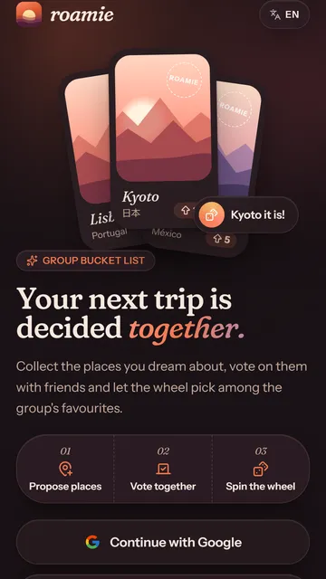
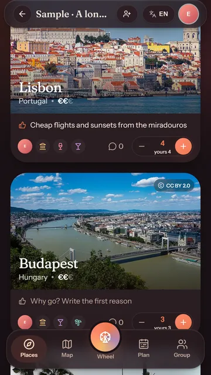
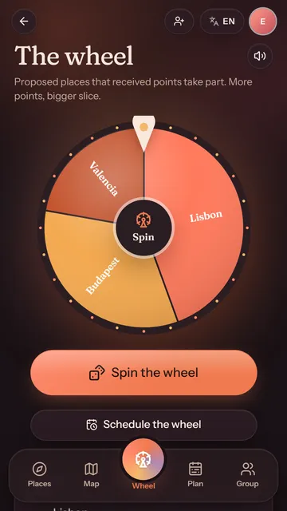
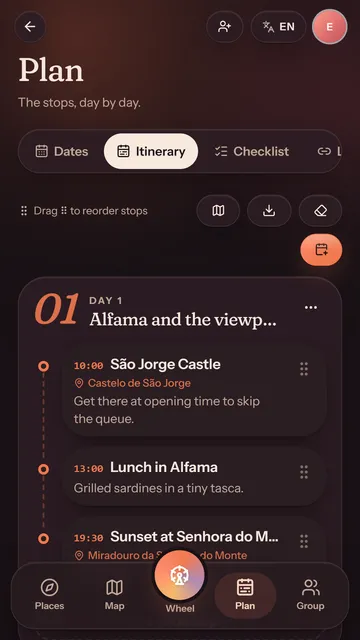
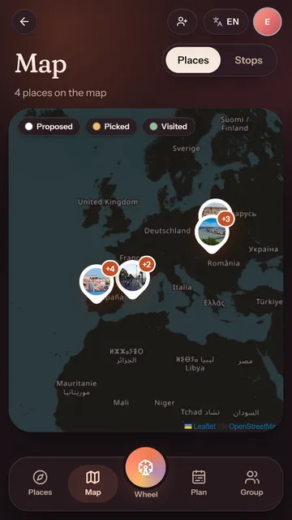

# Roamie

**Decide your next group trip, together.** Everyone proposes the places they'd love to visit, spreads 10 points across the
options, and a wheel weighted by the group's votes picks the destination. Then the group finds the dates that work for
everyone and plans the itinerary day by day.

**Live at [roamie.org](https://roamie.org)** · Android app in closed testing on Google Play · Italian, English and Spanish

<p>
  
  
  
  
  
</p>

## About this project

Roamie is a solo side project by **Ivan Pace**, designed and shipped end to end: product, web app, Android app,
backend, SEO and marketing automation. It was built with an AI coding assistant (Claude Code): I defined the product
and the priorities, made the decisions, tested everything on real devices and set up every external service; most of the
code was written by the assistant under that direction.

What it covers:

- **A complete product in production.** Group trips with invites and roles, point voting (optionally secret), a
  server-side weighted draw shared live with the whole group, date finding from everyone's availability, itinerary,
  checklist, map, passport of visited places, public trip pages, push notifications, offline mode. Three ways in:
  Google, an email code (no password), or just a name for friends arriving from an invite. Built to live next to the
  group chat: an invite link made to be pasted in WhatsApp or Telegram, a Telegram bot tells the group about new places and the wheel's pick, a secret budget shows only the ceiling everyone
  is fine with, and new trips walk their creator through invite, places and vote.
- **AI inside the product.** Destination ideas, comparisons and day-by-day itineraries (on the globe and inside a
  trip) from Mistral models (Supabase Edge Functions, free plan with automatic fallback between models). Only public
  facts and place names reach the model, never what members wrote.
- **SEO at scale.** 578 prerendered pages in three languages (13 travel guides, 36 "where to go in…" pages, 495
  destination comparisons) with hreflang, JSON-LD and a sitemap; React hydrates the prerendered markup.
- **Marketing automation.** A daily pipeline (Supabase pg_cron → GitHub Actions) plans a post from the guides, writes
  the copy with an LLM under automatic quality checks, renders a video (four formats, from a spinning wheel to a
  group-chat story) or a carousel with Remotion, publishes it to Instagram, Facebook, TikTok and YouTube, alerts on
  Telegram when a platform fails, and learns from Instagram insights which formats and which hook styles (question,
  POV, problem, challenge, opinion, curiosity) work best. A second bot writes one LinkedIn post a day for the company page (the week's changes, how
  groups decide, a destination, a feature, a lesson learnt) and posts it through a **Make.com** scenario, the only
  route LinkedIn opens to company pages without a partner review. Its texts are rejected if they invent a name that
  isn't in the facts they were given, repeat an earlier post, or read like AI (emoji, hype, long dashes). A weekly
  research step can turn what people say about planning trips with friends into angles for both bots, summarised in
  our own words, never quoted; it is paused until it has a source allowed by the platforms' API terms. Every Monday a
  report on Telegram shows the funnel that decides what to build next: trips created, reaching three people, voted,
  decided. See [`video/automation`](video/automation).
- **An AI team lead with a shared brain.** The project's memory lives in an **Obsidian** vault kept in a private
  repository: strategy, rules, a decision log, the backlog and every week's numbers, in plain Markdown that people
  and agents both read and write. Every Monday the report also checks the public pages in a real browser at three
  widths (objective layout problems only) and files the numbers in the vault; then **Capo**, a scheduled Claude Code
  agent in the cloud, reads them against the strategy, picks the one thing worth doing that week, writes the plan
  (its summary arrives on Telegram) and, when code is the answer, opens a small pull request for me to approve. Its
  job description and the rules it can't break are notes in the vault, so changing its behaviour means editing a note.
- **Measured performance.** Every optimisation was benchmarked on an emulated mid-range Android phone (4× CPU) against
  the previous release: tab-bar feedback 230–370 ms → ~45 ms, home LCP 1.9 s → 0.8 s, guide photos −84% (AVIF),
  initial JavaScript 311 → 190 KB, landing Lighthouse score 84 → 94 by cutting the fonts to what the design uses (the
  logo's font went from 150 KB to 3 KB).
- **Motion that stays smooth on a mid-range phone.** Page transitions with the View Transitions API (a trip's photo
  grows into the trip's header, moved by transforms only so the compositor plays it), a header and covers driven by
  CSS scroll-driven animations, a landing told as a scroll story (the picked postcard grows into the screen, the steps
  slide past a pinned section), micro-interactions with haptics, and a staged reveal of the wheel's winner. Each step
  was measured against the release before it: opening a trip and scrolling cost the same as without the animations.
- **Security and privacy by design.** Row Level Security on every table, server-side draws, strict Content-Security-
  Policy, no ads, no profiling cookies, account deletion and data export.

## How I built it with AI

Roamie is a working example of how I use AI to ship real software: one person, six weeks from the first commit
(13 September 2026), **199 commits**, about **36,000 lines** of TypeScript, **39 database migrations**, **6 Edge
Functions**, **6 GitHub Actions workflows** and **256 automated tests**. Almost every commit was written together with
[Claude Code](https://claude.com/claude-code), Anthropic's coding agent, and says so in its message. The git history
is the evidence: every change is small, explained and versioned.

### The loop

1. **I decide what to build and why**: from the weekly numbers, from what real groups do, or from something that felt
   wrong on my phone. I set the constraints too: privacy first, fast on a mid-range phone, no visual change without my
   approval.
2. **The agent reads the code, proposes a plan and implements it**, then runs the checks: types, lint, translations,
   unit tests and database tests (every migration runs on [PGlite](supabase/tests), an in-process Postgres).
3. **It verifies the result in a real browser** (Chrome driven through the DevTools protocol, Lighthouse, screenshots
   at phone and desktop widths) and shows me the proof; I test on a real Android phone.
4. **Every change ships as one small commit** with a bumped version (shown in the footer) and goes live on Vercel.

### Guardrails that make AI output reliable

- **Measure, don't guess.** Performance work is benchmarked on an emulated mid-range Android (4× slower CPU) against
  the previous build, and checked against Core Web Vitals from real visitors. Example: the landing's Lighthouse score
  went from 84 to 94 by cutting the fonts to what the design uses.
- **Tests and CI on every push** ([`ci.yml`](.github/workflows/ci.yml)), including small tests that guard decisions,
  like the one that keeps the inline theme script and its Content-Security-Policy hash in sync.
- **Security reviews**: Supabase's security advisors, a scan of the whole git history for leaked keys, Row Level
  Security on every table, privileged functions locked to the roles that need them.
- **Compliance done properly**: the YouTube API Services audit was passed after fixing what Google asked (official
  branding, 30-day retention of API data, an accurate privacy policy).
- **Cutting what doesn't work**: features are removed when real use says so ("paste the group chat" was clumsy on a
  phone), and false alarms in automated checks are verified by hand before they are silenced.

### LLMs in production, on a short leash

- **In the app**, Mistral models write destination comparisons, ideas and itineraries. They receive only place names
  and choices made with buttons, never what people wrote; every user has a daily quota and there is a global cap.
- **In the content bots**, the model writes only a hook and two sentences; the code owns every fact. Each line is
  checked before it ships: numbers or names that aren't in the facts, banned wording, the wrong language, long dashes,
  similarity to earlier posts. After a few rejected tries a hand-written line is used instead. See
  [`video/automation/copy.mjs`](video/automation/copy.mjs) and
  [`video/automation/linkedin/posts.mjs`](video/automation/linkedin/posts.mjs).

### Automation and agents

- **A daily social pipeline** ([`video/automation`](video/automation)): Postgres cron (pg_cron) starts a GitHub
  Actions workflow that plans a post from the travel guides, has the LLM write the copy, renders a video or a
  carousel with [Remotion](https://www.remotion.dev) (React), checks the output and publishes it to YouTube Shorts,
  Instagram, Facebook and TikTok, with a Telegram alert when a platform fails. It reads Instagram's numbers to favour
  the formats that work, without ever dropping the rules that keep the feed varied.
- **A daily LinkedIn post** through a Make scenario (built from Claude Code through Make's MCP server), plus a short
  draft for X sent to Telegram to post by hand.
- **A weekly report**: the funnel from Postgres, a page check in a headless browser, and the numbers filed in a private
  Obsidian vault, the project's shared memory.
- **Capo, a scheduled AI agent.** Every Monday a Claude Code routine in the cloud reads that vault (strategy, rules,
  decision log, backlog and the week's numbers), writes the week's plan, sends its summary to Telegram and may open
  one small pull request. Its job description and the rules it may never break are notes in the vault, so changing
  its behaviour means editing a note.

### Tooling

Claude Code with MCP servers (Supabase for migrations, SQL and advisors; Vercel for deployments; Make for the
LinkedIn scenario), agent skills (Remotion, marketing and directory submissions, design review), memory that persists
across sessions, and a built-in browser to check every visible change.

### What stays human

The product decisions and the priorities, what to cut, every account and every secret (the AI never handles keys or
passwords), testing on real devices, and the decision log. The AI writes most of the code; I decide which code is
worth writing.

*© 2026 Ivan Pace. All rights reserved: the source is published so it can be read, not reused (see
[LICENSE](LICENSE)).*

---

The rest of this file is the technical documentation.

## Stack

| Layer | Choice |
| --- | --- |
| App | Vite + React 19 + TypeScript |
| UI | Tailwind CSS v4, shadcn/ui-style components on Radix, vaul bottom sheets, Framer Motion, Lucide |
| Data | Supabase (Postgres + RLS, Google Auth, Realtime), TanStack Query |
| Maps | React-Leaflet + OpenStreetMap tiles, Nominatim geocoding |
| Photos | Wikimedia Commons API, with CC attribution always shown |
| Extras | canvas-confetti, dnd-kit (itinerary reordering), vite-plugin-pwa, i18next |
| Motion | View Transitions API, CSS scroll-driven animations, Web Animations; Framer Motion where a spring is needed |
| Automation | GitHub Actions started by Supabase pg_cron, Remotion (videos and carousels), Mistral (copy), Make.com (LinkedIn), Telegram (alerts and hand-posting kit) |
| Team memory | Obsidian vault in a private repository, read and written by a weekly Claude Code agent |
| Fonts | Fraunces + Instrument Sans, **self-hosted** via Fontsource (no Google Fonts requests) |

## Getting started

### 1. Install

```bash
npm install
```

### 2. Create the Supabase project (free)

1. Create a project at [supabase.com](https://supabase.com).
2. Apply the migrations in `supabase/migrations`, in filename order. Use one of these:
   - **CLI:** `npx supabase link --project-ref <ref>` and then `npx supabase db push`
   - **Dashboard:** paste each file into *SQL Editor* and run it
3. Go to *Authentication → URL Configuration*:
   - **Site URL:** your production URL, e.g. `https://roamie.org`
   - **Redirect URLs:** `http://localhost:5173/**` and `https://roamie.org/**`
4. In *Authentication → Sign In / Providers*, disable **Email**: Roamie only signs in with Google.

### 3. Enable Google sign-in

1. In [Google Cloud Console](https://console.cloud.google.com/), open *Google Auth Platform → Clients* and create an **OAuth client** of type *Web application*.
   - **Authorized redirect URI:** `https://<project-ref>.supabase.co/auth/v1/callback`
2. In *Branding*, set these app links. Both pages exist in the app:
   - **Privacy policy:** `https://roamie.org/privacy`
   - **Terms of service:** `https://roamie.org/terms`
   - **Scopes:** only `email`, `profile` and `openid`
3. In Supabase, go to *Authentication → Providers → Google* and paste the client ID and secret.

### 3b. Email sign-in with a code (optional)

"Use your email" sends a 6-digit code (`signInWithOtp` / `verifyOtp`, `src/components/auth/EmailSignIn.tsx`); new
addresses get an account on first use, with the name typed next to the email.

1. Verify the domain on [Resend](https://resend.com) (its DNS records go in Cloudflare, DNS only).
2. In Supabase, *Authentication → Emails → SMTP Settings*: host `smtp.resend.com`, port `465`, username `resend`,
   password the Resend API key, sender `accesso@roamie.org`.
3. *Authentication → Sign In / Providers → Email*: enable the provider.
4. *Authentication → Email Templates*: in both **Confirm signup** (first sign-in) and **Magic Link** (the next ones),
   put `{{ .Token }}` in the body and the subject instead of `{{ .ConfirmationURL }}`, so the email carries the code.

### 4. Environment

```bash
cp .env.example .env.local
```

| Variable | Purpose |
| --- | --- |
| `VITE_SUPABASE_URL` | Project URL. Also written into the Content-Security-Policy at build time. |
| `VITE_SUPABASE_ANON_KEY` | anon / publishable key. It is public by design; RLS protects the data. |
| `VITE_PUBLIC_APP_URL` | Base URL for invite links and the OAuth redirect. `https://roamie.org` in production; leave it empty locally. |
| `VITE_CONTACT_EMAIL` | Contact shown in the Privacy Policy. It is also sent to Nominatim/Wikimedia to identify the app. |

### 5. Run

```bash
npm run dev
```

In development, **`/__preview`** renders the trip screens with mock data, so you can review the UI without a Supabase project. Try `/__preview/trips`, `/places`, `/map`, `/roulette`, `/itinerary` and `/group`. This route is stripped from production builds.

## Scripts

| Script | What it does |
| --- | --- |
| `npm run dev` | Dev server |
| `npm run build` | Typecheck, production build (PWA service worker included), then prerender the public pages and fill in `_headers` |
| `npm run preview` | Serves `dist/` with the production security headers, to check the CSP locally |
| `npm test` | Unit tests plus **database tests**: the real migrations run on PGlite (Postgres in WASM) to verify RLS, invites, votes, the weighted roulette, hardening and account deletion, with no Supabase needed |
| `npm run i18n:check` | Checks that all locales have the same keys and that every `t('…')` key exists |
| `npm run types` | Regenerates `src/lib/database.types.ts` from the live schema (run `npx supabase login` once). Run it after every migration: the Supabase client is typed with it, so wrong table, column or RPC names fail the build |
| `npm run icons` | Regenerates the PWA icons from `public/favicon.svg` |
| `npm run og-image` | Regenerates the social preview images in `public/og/` |
| `npm run guide-photos` | Makes the AVIF copies of the guides' photos and covers in `public/guides/photos/` (existing files are kept) |
| `npm run bump` | Raises the patch version before every push; the version is shown in the footer next to the copyright |
| `python scripts/fonts.py` | Cuts the display fonts to what the design uses: Fraunces upright with its soft/wonky axes pinned, and the logo's 3 KB wordmark (needs `pip install fonttools brotli`) |

## Architecture notes

- **Security model.** Every table has RLS. Membership checks go through `SECURITY DEFINER` helpers (`is_trip_member`, `can_edit_trip`, `is_trip_owner`), which avoids recursive policies on `trip_members`. The helpers aren't callable by `anon`. Column-level `UPDATE` grants make ids, `trip_id`, `owner_id` and authors immutable.
  - Owner: everything
  - Editor: destinations, itinerary, roulette
  - Viewer: read, vote and comment on their own content
- **User-supplied URLs.** Photos can only be Wikimedia Commons files (`upload.wikimedia.org`) or built-in scenes, enforced by check constraints and again in the client. Avatars can only be Google URLs. Attribution links are https only. This blocks tracking pixels and CSS/HTML injection from other group members.
- **HTTP headers.** `vercel.json` sets a strict Content-Security-Policy (no inline scripts, only the hosts the app talks to), HSTS, `X-Frame-Options: DENY`, `nosniff`, a restrictive Permissions-Policy, and long-lived caching for hashed assets.
- **RPCs:**
  - `get_trip_preview`: the only thing `anon` can call. It returns name, cover and member count.
  - `join_trip`, `regenerate_invite_code`, `set_points`, `spin_roulette`, `delete_account`
- **Point voting.** Every member has 10 points per trip to spread across its proposed destinations (`set_points`; 0 removes them). A trigger enforces the budget under an advisory lock, so concurrent requests can't overspend; selected or visited destinations don't count, so a spin gives their points back.
- **Trip plan.** The "Plan" tab holds the itinerary, a shared checklist (`checklist_items`: to book / to pack, assignable only to trip members, `done_at` kept by a trigger) and useful links (`trip_links`: http(s) URLs and notes, no uploads). Members read; owners and editors write. Stops can have a place (same search as destinations) and appear on the map as numbered routes, one colour per day; the itinerary exports to an `.ics` file (`src/lib/ics.ts`): timed stops as 1-hour events in floating local time, the rest as all-day events.
- **Choosing dates.** Owners and editors set a window and the trip length on `trips`; every member marks days as free or maybe (`availability`, written through `set_availability`). The Dates view shows a calendar coloured by how many are free and the best non-overlapping windows (`src/lib/dates.ts`: a "maybe" counts half); fixing a window sets `start_date`/`end_date`.
- **Offline trips.** The service worker precaches the app shell and every chunk; the TanStack Query cache is persisted to IndexedDB (`src/lib/offline.ts`, 20 days: it doubles as the queries' `gcTime`, and setTimeout overflows above ~24.8 days) for the user's trips, each trip's data, the profile and the passport. Opening a trip loads all its views at once, so it stays readable without a connection. Offline, an expired access token can't be refreshed, so `useAuth` falls back to the stored session until the network is back. The copy is deleted on sign-out and when another account signs in on the device.
- **Roulette.** Eligible destinations are `proposed` with at least one point. The draw is **server-side** (`spin_roulette`), weighted by points and serialised with a row lock, so no client can choose the winner. The client animates the wheel to the returned result, and each slice's size equals its real probability.
- **Realtime.** There is one channel per open trip, covering destinations, votes, comments, members and itinerary. Changes invalidate TanStack Query caches, debounced. DELETE payloads carry only primary keys, so relevance is checked against the cache.
- **Invites.** Codes are 8 characters from an alphabet without look-alike characters, generated from `gen_random_uuid()` bytes. Regenerating a code invalidates the old link immediately; existing members keep their access.
- **SEO.**
  - The public pages are prerendered at build time (`src/entry-prerender.tsx` + `scripts/prerender.mjs`): `/` (Italian), `/en`, `/es`, `/privacy`, `/terms`, `404.html` and the guides. Each ships its real content, title, description, canonical, Open Graph/Twitter tags and, on the landing, hreflang alternates and JSON-LD (`WebSite`, `Organization`, `WebApplication`, `FAQPage`).
  - Every landing URL has a fixed language; the language switcher moves between them. `useSeo` keeps the same tags in sync on client-side navigation.
  - Signed-in routes and invite links are served by `shell.html` (`noindex`) through the rewrites in `vercel.json`; unknown paths get a real 404 status. `robots.txt` is in `public/`; `sitemap.xml` is generated from the prerendered routes, with hreflang alternates.
  - **Inspiration guides.** 12 guides (`src/content/guides/`) in three languages, each with its own URL (`/guide/…`, `/en/guides/…`, `/es/guias/…`), hreflang, `Article`/`HowTo`/`BreadcrumbList` JSON-LD, and links from the landing and the footer. Every destination has an "Add to a trip" action that proposes it in one of your trips, with coordinates, mood, budget and a Commons photo.
- **Place search.** Typing shows suggestions from [Photon](https://photon.komoot.io) (debounced, superseded requests aborted, only real places, cached). Nominatim's usage policy forbids autocomplete, so Nominatim is only called explicitly: the full search ("Search …" or Enter) and one lookup when a suggestion is picked, to get its name in the UI language (Beijing → Pechino). Nominatim calls go through a global client queue limited to 1 request per second and are cached in localStorage. Browsers can't set `User-Agent`, so the app identifies itself with the `Referer` header and the `email` parameter.
- **Animations.** `src/lib/viewTransition.ts` wraps navigation in a view transition: the shared photo gets its
  `view-transition-name` only during the transition (a named element would switch off the glass blur inside it), moves
  by translate and scale (`html.vt-morph`), and heavy pages render their header first and the rest once the animation
  has started (`usePageSettled`). The app header and the trip and guide covers follow the scroll with
  `animation-timeline: scroll()` (with a one-step fallback where it isn't supported); everything animates transform and
  opacity only, and parallax is off with reduced motion.
- **Guide covers.** `src/content/guides/covers.json` holds each guide's cover photo (the photo of its first place, kept
  equal by a test; the guides without places have their own; a guide's page opens on its last place instead, so the
  first place card doesn't repeat the photo above it), small enough for the landing page to show photos without downloading
  the guides. The landing's postcards use their own cropped AVIFs in `public/landing/`, credited like every photo.
- **Wikimedia images.** Lookup tries the Wikipedia lead image first, resolved on Commons (so only freely licensed files are used), then a Commons file search whose titles must contain the place name. Maps, flags, coats of arms and tiny files are discarded. If nothing relevant remains, the card shows an illustrated scene instead. Attribution (author, licence, source) is stored as JSON and shown on every image.
- **Passport.** `/passport` collects the visited destinations of all your trips (RLS scopes the query) and places you add yourself (`visited_places`, readable only by their author): countries and continents reached (ISO code from the place search, localized with `Intl.DisplayNames`), a map, and stamps with ratings, filterable by trip. "I wasn't there" (`passport_exclusions`) hides a group visit from your passport only. `visited_at` is kept by the status trigger; members rate visited destinations 1–5 with `set_rating` (0 removes it). The share button draws a 1080×1920 story image on a canvas in the browser (`src/lib/passportCard.ts`) and hands it to the system share sheet, or downloads it.
- **Public trip page.** Off by default. The owner can publish a read-only page at `/p/:slug` (`set_trip_public`): the slug is the trip name plus 8 random characters, so pages can't be enumerated. `get_public_trip` is the only data `anon` gets besides the invite preview: trip details, destinations with photo and total points, and the itinerary. Members, individual votes, comments, links and the checklist are never included. On Vercel, `api/public-trip.ts` serves the app shell with the trip's own title, description, image, canonical and `TouristTrip` JSON-LD, so link previews and search engines show the trip (CDN cache 60 s, so unpublishing takes previews down quickly).
- **Climate.** Destinations with coordinates show their average climate from Open-Meteo's historical weather API (free for non-commercial use, CC BY 4.0, credited next to the chart): 5 years of daily data reduced to 12 months, cached for 180 days on a ~25 km grid. The "best time to go" is an estimate from daytime highs (18–28 °C ideal) and rainy days (`src/lib/climate.ts`). Compare mode puts 2–3 destinations side by side (points, best time, budget, mood, comments).
- **Joining.** An invite link joins with just a name (an anonymous Supabase user, linkable to Google later), Google or
  an email code. Its link preview (`api/join.ts`, `api/og/invite`) shows the trip, the places in the running and that a
  name is enough. After a proposal, and after the last of your points, a toast offers to tell the group in the chat with
  the message ready (`useTellTheGroup`). New trips show their creator three steps (invite, places, vote) that tick
  themselves off (`FirstSteps`).
- **Telegram groups.** `supabase/functions/telegram-bot` is @RoamieTripBot. Adding it from the invite page
  (`t.me/RoamieTripBot?startgroup=<code>`) links the group to the trip; triggers queue what happens in the trip
  (`telegram_outbox`: a place proposed, someone joining, the wheel's pick, dates fixed) and pg_net asks the function to
  send it. In groups the bot only receives commands (`/mete`, `/collega`, `/scollega`), never the chat. Needs the
  Edge Function secret `TELEGRAM_GROUP_BOT_TOKEN`; `GET …/telegram-bot?setup` registers the webhook and the menu.
- **Secret budget.** Each member picks a band privately (`set_my_budget`); `group_budget` returns only the lowest band,
  and only once three have answered, so no answer can be told apart. Nobody, the owner included, can read
  `trip_budgets`.
- **Weekly report.** `public.funnel_report()` counts the funnel (real trips are the ones a Google or email account made);
  the `funnel-report` Edge Function serves it to the Monday workflow (`report.yml`, started by pg_cron), which posts it
  on Telegram. The same workflow builds `main`, runs taste-skill's `inspect.mjs` (pinned commit) on six public pages
  keeping only objective layout rules (`video/automation/qa.mjs`), and writes funnel, the week's posts and the page
  check to the private brain repository as `Numeri/<ISO week>.md` (`brain.mjs`, secret `BRAIN_TOKEN`). Funnel numbers
  never land in this public repository.
- **Capo (weekly agent).** A Claude Code routine runs on Mondays at 09:00 UTC with the brain and this repository checked
  out. It follows `Agenti/Capo.md` and `Regole.md` from the vault: compare the week's numbers, choose one action, write
  `Piani/<ISO week>.md` (a workflow in the brain repository sends its summary to Telegram) and, if needed, open one
  pull request here from a `capo/…` branch after lint, typecheck and tests. It never pushes to `main`, holds no
  secrets and has no connectors.
- **Privacy.** There are no third-party trackers and no consent banner: the only analytics is Cloudflare Web Analytics, cookieless and anonymous. Only strictly necessary storage is used (Supabase session, language, theme, sound preference, API caches), and all of it is disclosed in the Privacy Policy. Users can export their data as JSON and delete their account from the Profile page.

## Deploying (Vercel)

1. Push the repository to GitHub. Database backups live in a separate **private** repository (see below), since workflow artifacts of a public repository can be downloaded by anyone.
2. Import it in Vercel. `vercel.json` sets the build (`npm run build` → `dist`), clean URLs, rewrites, headers and caching. Set the four `VITE_` variables above in *Settings → Environment Variables* (Production and Preview); locally they live in `.env.local` or `.env.production`, both ignored by git.
3. In Supabase *Authentication → URL Configuration*, add the Vercel domain to **Redirect URLs** (e.g. `https://roamie.vercel.app/**`) so Google sign-in works there too.
4. Under *Settings → Domains*, add `roamie.org` and `www.roamie.org` (redirecting to the apex), then point the DNS records at Vercel as instructed.

## Backups and keep-alive

The Supabase free plan has no downloadable backups and pauses projects after about a week without activity.

- **Backups** run every Monday from a separate **private** repository (`roamie-backups`): dumps contain personal data, and
  artifacts of a public repository are downloadable by anyone. It dumps roles, schema and data with the Supabase CLI and
  keeps them as a workflow artifact for 90 days; it needs the secret `SUPABASE_DB_URL` (Supabase → *Connect* →
  *Session pooler* connection string).
- **`supabase-keepalive.yml`** (here) runs one read-only RPC every day. Add the repository variables `SUPABASE_URL` and
  `SUPABASE_ANON_KEY`.

**Test a restore** before you need one. Download an artifact, create a second free Supabase project, and run:

```bash
psql --single-transaction --variable ON_ERROR_STOP=1 --file roles.sql --file schema.sql --command 'SET session_replication_role = replica' --file data.sql --dbname "<new project connection string>"
```

## Launch checklist

- **Search:** verify `roamie.org` as a *Domain* property in Google Search Console (DNS TXT record in Cloudflare), submit `https://roamie.org/sitemap.xml`, then import the site into Bing Webmaster Tools. Check *Pages* and *Core Web Vitals* reports after launch, and use PageSpeed Insights on `/`.
- **Monitoring:** add free uptime checks (for example UptimeRobot) for `https://roamie.org/` and `https://<project-ref>.supabase.co/auth/v1/health`.
- **Accounts:** turn on two-factor authentication for Cloudflare, Supabase, Google Cloud and GitHub.
- **Google OAuth:** publish the app in *Google Auth Platform → Audience* once branding is verified.

Keep these free-tier limits in mind:

- **OpenStreetMap tiles:** the public tile servers are meant for light use. If traffic grows, switch the `TileLayer` URL to another free or self-hosted provider, and update `img-src`/`connect-src` in `vercel.json`.
- **Supabase Auth emails:** sent through Resend's SMTP (sign-in codes only; see *3b*). Resend's free plan covers
  3,000 emails a month.
